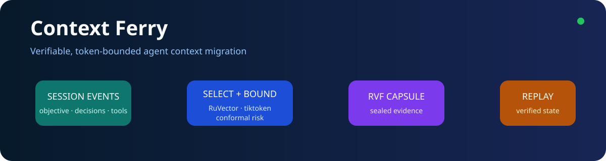
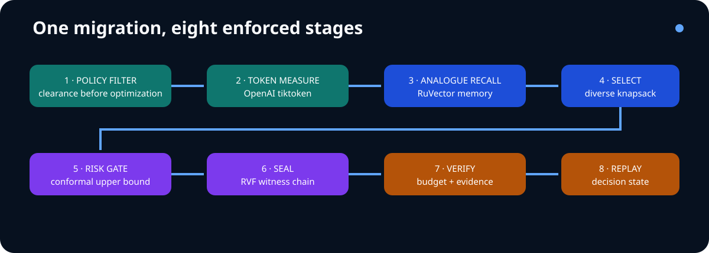

<div align="center">


# Context Ferry

**Move an agent's decision state across inference boundaries without copying the whole transcript or trusting an unverifiable summary.**

  
</div>

Context Ferry builds a policy-filtered, token-bounded, semantically recalled, conformal-risk-gated and RVF-sealed context capsule. A destination verifies the capsule before deterministic replay.

## Quickstart

```bash
python3 -m pip install tiktoken==0.12.0
cargo run --locked -p cf-cli --bin context-ferry -- example
cargo run --locked -p cf-cli --bin context-ferry -- evaluate
```

The example migrates objectives, constraints, decisions, tool observations, a rejected unsafe action and pending work to an internal edge runtime. A secret event is filtered before any optimization or persistence.

## Executed composition

| Ingredient | Responsibility | Real boundary |
| --- | --- | --- |
| RuVector Core 2.4.0 | Analogue context memory | VectorDB insert/search |
| RVF Crypto 0.2.0 | Tamper-evident transfer evidence | Witness create/verify/tamper reject |
| OpenAI tiktoken 0.12.0 | Target-encoding token measurement | Bounded Python subprocess, cl100k_base |
| Conformal risk control | Omission-risk release gate | Native Rust finite-sample upper quantile |
| Ruflo 3.56.10 | Coordination provenance | Source-bound CLI receipt, authority none |
| MetaHarness Darwin/Flywheel | Advisory suite and replay | Source-bound receipts, authority none |

## Workspace

The workspace contains 23 meaningful crates covering typed domain values, intake, policy, budgeting, enterprise tokenization, RuVector recall, diverse selection, conformal risk, capsule exchange, RVF evidence, verification, replay, runtime, interfaces and evaluation. See [the complete crate map](docs/architecture.md), [integration matrix](docs/integration-matrix.md), [ADRs](docs/adrs/index.md), and [DDD context map](docs/ddd/index.md).



## Evaluation

The frozen workload produced these source-bound results:

| Mode | Released | Selected | Tokens | Recall | Evidence | Robust gate | Replayed decisions | Objective |
| --- | --- | ---: | ---: | --- | --- | --- | ---: | ---: |
| combined | yes | 4 | 36 | yes | yes | yes | 1 | 37.0 |
| no RuVector | yes | 4 | 36 | no | yes | yes | 1 | 37.0 |
| no RVF | yes | 4 | 36 | yes | no | yes | 1 | 36.0 |
| no tiktoken | no | 0 | 0 | no | no | no | 0 | 0.0 |
| no conformal gate | yes | 4 | 36 | yes | yes | no | 1 | 36.0 |
| enterprise only | yes | 4 | 36 | no | no | no | 1 | 35.0 |
| Ruvnet only | yes | 2 | 34 | yes | yes | no | 0 | 18.3 |

Removing tiktoken caused the frozen approximate counter to violate the risk ceiling and fail closed. Removing RuVector eliminated recall; removing RVF eliminated evidence; removing the conformal gate removed robust release assurance. See [raw evaluation evidence](evidence/raw/evaluation.json) and [integration evidence](evidence/integration-evidence.md).

## Safety and limitations

- No paid model API is called; the destination is represented as a typed boundary.
- Conformal validity depends on exchangeability between calibration and operational omission loss.
- The transparent four-dimensional event embedding is reproducible, not a production embedding model.
- RVF proves integrity and ordering, not semantic completeness or truth.
- Python plus official tiktoken is an operational dependency isolated behind one crate.

Apache-2.0 licensed. Upstream licenses and exact revisions are recorded in [research](docs/research.md).
